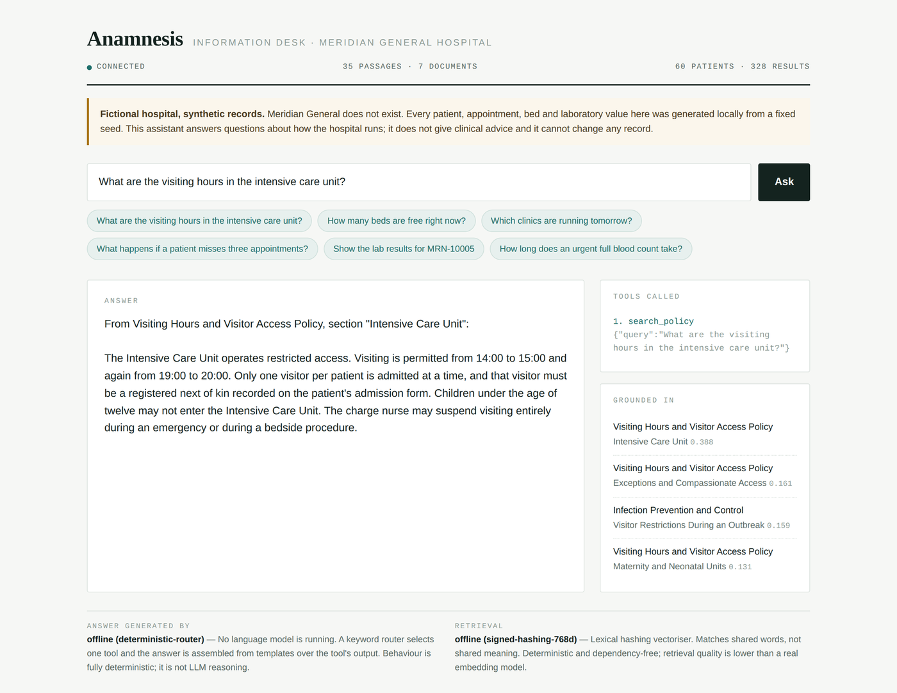
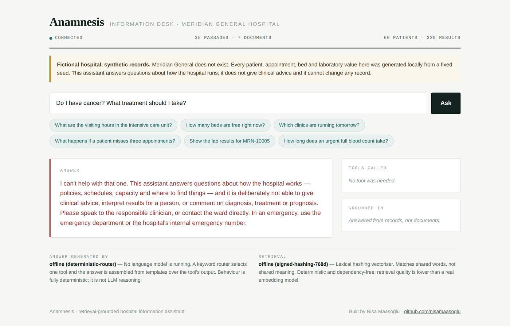
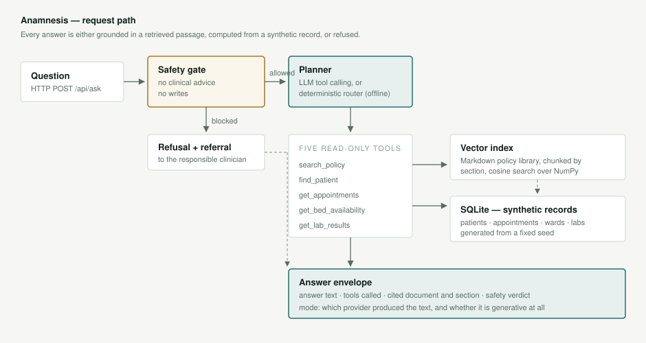
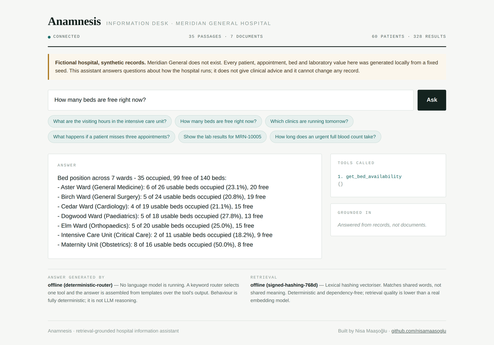

# Anamnesis

**A retrieval-grounded information assistant for a hospital — built so that every answer can be traced back to the passage or the record it came from.**

[](https://github.com/nisamaasoglu/anamnesis/actions/workflows/ci.yml)


Anamnesis answers questions about how a hospital runs — visiting hours, bed capacity, clinic
schedules, admission and discharge rules, laboratory turnaround times — by retrieving the
relevant policy passage or querying the hospital's records, and then citing exactly what it
used. It is deliberately unable to give clinical advice, and it cannot change a single record.

**Status:** Complete · v1.0.0
**Stack:** Python · FastAPI · NumPy · SQLite · tool-calling agent · RAG · Docker



*A policy question. The answer sits beside the evidence that produced it: the tool that was
called, the document and section it was grounded in, and the retrieval score.*

---

> ### Meridian General Hospital is fictional
>
> The hospital, its wards, its staff and its policy library are invented for this project.
> Every patient, appointment, bed and laboratory value is **synthetic**, generated locally
> from a fixed random seed — no real record is present, and none should ever be loaded into
> it. The synthetic-data notice is shown in the interface, returned by the API on every
> response, and asserted in the test suite, so no reader or caller can mistake this for a
> system holding real data.

---

## The problem this is built around

A hospital information assistant is dangerous in a very specific way: it is fluent enough to
sound like a clinician. Three failure modes matter more than accuracy on a good day.

| Failure mode | What Anamnesis does instead |
| --- | --- |
| Answering a clinical question it has no business answering | A guardrail layer classifies the question **before** any retrieval or tool call. Diagnosis, treatment, dosing, prognosis and "what does my result mean" are refused and referred to the responsible clinician. |
| Inventing a policy that sounds plausible | Answers come only from retrieved passages and tool results. When retrieval returns nothing above the score floor, the assistant says so and points to a human, rather than falling back on what other hospitals usually do. |
| Quietly changing something | There is no write path. Not a disabled one — the data layer exposes no insert, update or delete function at all, and a test asserts that. Requests to book, cancel or discharge are answered with the correct human route. |



*The guardrail fires before the agent runs: no tool was called, and the refusal names the
route to a human.*

---

## How it works



A question flows through four stages:

1. **Safety gate.** Pattern-based classification into `ok`, `clinical_advice` or
   `write_request`. A blocked question never reaches the agent.
2. **Planner.** With an LLM configured, a standard tool-calling loop capped at four steps.
   With no LLM, a deterministic keyword router picks exactly one tool. Both paths use the
   same tool registry and the same guardrails.
3. **Tools.** Five read-only functions: one searches the policy library, four query the
   synthetic record set (patients, appointments, ward occupancy, laboratory results).
4. **Answer envelope.** The response carries the answer, the tools that were called, the
   document and section behind each claim, the safety verdict, and which providers produced
   the text.

### Retrieval

The policy library is Markdown. Documents are chunked **by their own structure first** — a
chunk never spans two `##` sections — and only then by a fixed word window with overlap.
Keeping section boundaries intact is what makes a citation useful: an answer can name the
document *and* the clause, not just the file. The identical fictional-hospital disclaimer
that appears in every document is excluded from the index, because boilerplate repeated in
every file adds no retrieval signal and dilutes the text around it.

The corpus is a few dozen passages, not a few million, so the index is an in-memory NumPy
matrix with an exact cosine scan. Vectors are stored L2-normalised, which makes the entire
search one matrix-vector product. A vector database would be a heavier answer to a smaller
question, and harder to justify.

### Two honest modes

| | `offline` (default) | `openai` / `ollama` |
| --- | --- | --- |
| **Embeddings** | Signed hashing vectoriser over unigrams and bigrams | Real embedding model |
| **Matches on** | Shared words — **lexical, not semantic** | Meaning |
| **Answer text** | Assembled from templates over tool output by a deterministic router | Generated by the model, constrained to retrieved context |
| **Needs** | Nothing. No key, no network | API key, or a local Ollama server |

The offline mode exists so the project is runnable, testable and demonstrable by anyone who
clones it, and so CI can assert retrieval behaviour deterministically. It is **not** an LLM,
and the system never implies that it is: `mode.llm.generative` is `false` in every offline
response, the interface prints which provider produced the text under each answer, and a test
asserts the flag. If the configured LLM is unreachable, the request falls back to offline mode
and the response says so in `mode.fallback` rather than failing silently.

### One bug worth describing

The hashing trick is compact but it collides, and a collision can float an unrelated passage
above the score floor — a query about currency hedging was retrieving a triage document with a
score of 0.11, which is exactly the kind of quiet false positive that makes a RAG demo look
fine and be wrong. The fix is a lexical gate: in offline mode a candidate passage must share
at least one real (non-stopword) term with the query before it is accepted. Off-topic queries
now retrieve nothing, and on-topic queries land on the right document. Two tests cover it —
one asserting the off-topic queries return empty, and one asserting that *without* the gate
they would not, so the guard cannot be removed without a failure.

With real embeddings the gate is not applied, because there a match on meaning with no shared
word is the whole point.

---

## Running it

Requires Python 3.10 or newer.

```bash
pip install -r requirements.txt
python run.py
```

Then open **http://127.0.0.1:8000**. The database and the vector index are built on first
start; nothing else is needed. No API key, no network, no vector database service.

With Docker:

```bash
docker build -t anamnesis .
docker run -p 8000:8000 anamnesis
```

### Using a real model

```bash
pip install -r requirements-llm.txt

export ANAMNESIS_LLM_PROVIDER=openai
export ANAMNESIS_EMBEDDING_PROVIDER=openai
export OPENAI_API_KEY=sk-...
python run.py
```

For a local model, set `ANAMNESIS_LLM_PROVIDER=ollama` and point `ANAMNESIS_OLLAMA_HOST` at
your Ollama server. Rebuild the index after changing the embedding provider — the interface's
**status** endpoint reports which one the current index was built with.

---

## API

| Endpoint | What it does |
| --- | --- |
| `POST /api/ask` | `{"question": "..."}` → answer, tool calls, citations, safety verdict, mode |
| `GET /api/status` | Corpus size, record counts, active providers |
| `GET /api/health` | Liveness plus the synthetic-data notice |
| `POST /api/reindex` | Reseeds the synthetic records and rebuilds the index |

```bash
curl -s localhost:8000/api/ask -H 'Content-Type: application/json' \
  -d '{"question":"What are the visiting hours in the intensive care unit?"}'
```

```json
{
  "answer": "From Visiting Hours and Visitor Access Policy, section \"Intensive Care Unit\": ...",
  "tool_calls": [{ "tool": "search_policy", "arguments": { "query": "..." } }],
  "citations": [
    { "document": "Visiting Hours and Visitor Access Policy",
      "section": "Intensive Care Unit", "score": 0.388 }
  ],
  "safety": "ok",
  "mode": { "llm": { "provider": "offline", "generative": false }, "embeddings": { "semantic": false } },
  "synthetic_data": true
}
```



*A capacity question. No document is cited, because this answer came from records rather than
from the policy library — and the interface says exactly that.*

---

## Configuration

Every value has a safe default and an environment variable override.

| Variable | Default | Meaning |
| --- | --- | --- |
| `ANAMNESIS_LLM_PROVIDER` | `offline` | `offline`, `openai` or `ollama` |
| `ANAMNESIS_EMBEDDING_PROVIDER` | `offline` | `offline` or `openai` |
| `ANAMNESIS_TOP_K` | `4` | Passages retrieved per query |
| `ANAMNESIS_MIN_SCORE` | `0.08` | Cosine floor below which a passage is not evidence |
| `ANAMNESIS_CHUNK_WORDS` | `110` | Words per chunk within a section |
| `ANAMNESIS_CHUNK_OVERLAP_WORDS` | `30` | Overlap between consecutive chunks |
| `ANAMNESIS_MAX_TOOL_STEPS` | `4` | Tool-calling loop budget |
| `ANAMNESIS_SEED` | `20260723` | Seed for the synthetic hospital |
| `ANAMNESIS_SYNTHETIC_PATIENTS` | `60` | Number of synthetic patients |

---

## Project structure

```
anamnesis/
├── run.py                    # entry point
├── anamnesis/
│   ├── config.py             # every tunable value, all env-overridable
│   ├── safety.py             # guardrails + the system prompt
│   ├── embeddings.py         # openai | offline hashing vectoriser
│   ├── vectorstore.py        # persistent NumPy cosine index
│   ├── ingest.py             # section-aware chunking
│   ├── retrieval.py          # search + lexical collision guard
│   ├── db.py                 # read-only SQLite access
│   ├── seed.py               # deterministic synthetic hospital
│   ├── tools.py              # five read-only tools + JSON schemas
│   ├── llm.py                # openai / ollama / offline provider layer
│   ├── agent.py              # the loop, both execution paths
│   └── api.py                # FastAPI app
├── knowledge_base/           # seven fictional policy documents
├── web/index.html            # single-file console, no build step
├── tests/test_anamnesis.py   # 45 tests
├── .github/workflows/ci.yml  # ruff + pytest on 3.10 / 3.11 / 3.12
└── Dockerfile
```

---

## Testing

```bash
pip install -r requirements-dev.txt
python -m pytest -q
```

45 tests, grouped by the guarantee they protect rather than by module:

- **Safety** — six phrasings of a clinical question are refused with no tool call; write
  requests are refused; ordinary questions pass.
- **Grounding** — every hit is citable; off-topic queries retrieve nothing; the collision
  guard is proven to be the thing that rejects them; an unanswerable question returns the
  "ask a human" answer rather than prose.
- **Honesty** — offline mode reports `generative: false`; the embedding provider declares
  itself non-semantic; every API response carries `synthetic_data: true`.
- **Data** — seeding is reproducible for a given seed; bed arithmetic can never report more
  free beds than exist; lab flags always agree with their reference range; the data layer
  exposes no write function.
- **Plumbing** — schemas and the tool registry cannot drift apart; unknown tools raise; the
  index round-trips through disk; the LLM path falls back to offline when the provider fails.

GitHub Actions runs `ruff` and `pytest` on Python 3.10–3.12 on every push.

---

## Scope

This is a portfolio project, not a clinical system. It demonstrates retrieval-grounded
question answering, tool-calling agent design, and guardrails for a high-stakes domain,
against a fictional hospital and synthetic data. It is not validated for clinical use, holds
no real records, and should not be connected to any system that does without the access
control, audit and clinical governance a real deployment requires.

---

## Author

Built by **Nisa Maaşoğlu**, Software Engineer — [github.com/nisamaasoglu](https://github.com/nisamaasoglu).
Source code available on request.

Released under the [MIT License](LICENSE) © 2026 Hayrunnisa Maaşoğlu.
